# Hotel Price Prediction and Tourism Analytics

**Analyse des hôtels et prédiction des tarifs touristiques**

A complete, executed educational data-science project using a licensed **Booking.com research snapshot**: automatic collection, data-quality checks, room-price regression, Random Forest / Gradient Boosting / XGBoost tuning, K-Means positioning, statistical analysis and an interactive tourism dashboard.

**Measured results:** 225 valid one-room quotes for **163 establishments**, across **9 Barcelona districts**. Selected estimator: **xgboost**. Property-disjoint test MAE **€51.15 / night**, RMSE **€99.85**, R² **0.114**. The selected model does not beat every simple baseline on this held-out sample; the full comparison below is part of the result, not hidden.

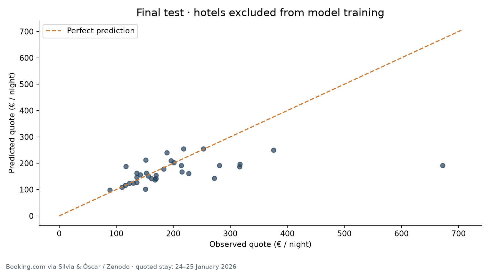

## Contents

- [Quick start](#quick-start)
- [Data provenance and licensing](#data-source-provenance-and-licensing)
- [Web scraping](#web-scraping)
- [Schema and cleaning](#data-schema)
- [Evaluation and regression](#leakage-resistant-evaluation)
- [Measured test results](#measured-test-results)
- [Statistical analysis](#statistical-and-visual-analysis)
- [K-Means positioning](#k-means-hotel-positioning)
- [Tourism dashboard](#dashboard)
- [Prediction examples](#real-prediction-examples)
- [Limitations](#limitations-and-next-steps)

## Quick start

Python 3.12 recommended. Run from the repository root:

```bash
python -m venv .venv
# Windows: .venv\Scripts\Activate.ps1
# macOS / Linux: source .venv/bin/activate
python -m pip install -r requirements-lock.txt
python -m pytest -q
python -m src.predict --input examples/hotel.csv --output predictions.csv
python -m http.server 8000
```

To reproduce collection, cleaning, training, figures, documentation and dashboard:

```bash
python -m src.run
```

To train from the committed processed cohort without downloading data:

```bash
python -m src.train
```

To intentionally refresh the original snapshot:

```bash
python -m src.collect --refresh
python -m src.run --skip-download
```

The snapshot is less than 1 MB; model training evaluates 36 cross-validation fits plus refits. Direct package versions used for the executed results are in [requirements-lock.txt](requirements-lock.txt); transitive dependencies are not fully pinned. [Environment details](reports/environment.json) record the execution versions. Fitted artifacts are included and can be regenerated. Load only trusted joblib files.

## Objectives and delivered components

- **Automatic collection:** versioned Booking.com-derived data retrieved programmatically from Zenodo, with source MD5 and local SHA256 verification. An optional direct HTML scraper is also implemented and tested.
- **Price factors:** district, centrality, beach proximity, requested adults, review count, sustainability certification and service mentions extracted from descriptions.
- **Regression:** Random Forest, histogram Gradient Boosting and XGBoost; grouped cross-validation and independent validation/calibration/test hotel sets.
- **Segmentation:** three property groups named **Economy**, **Mid-range** and **Upscale**, ordered by their training-property median quoted price.
- **Dashboard:** linked filters, updated KPIs, district medians, distance/price scatter plot, sortable hotel quotes, held-out predictions and CSV export.

This is a bounded study of **advertised search-result quotes** for **24–25 January 2026**, captured in November 2025. It does not predict realized transaction prices or current hotel rates. All retained offers request one room, one night, 1–3 adults and one child aged **0**. It should not be applied to other dates or occupancy patterns without new data and evaluation.

## Data source, provenance and licensing

Dataset: **Silvia & Óscar (2025), “Alojamientos y precios en Booking.com (Barcelona, 2026)”**, [Zenodo record](https://zenodo.org/records/17560799), DOI [10.5281/zenodo.17560799](https://doi.org/10.5281/zenodo.17560799).

- Published: **2025-11-08**; download timestamp, exact URL, byte count and hashes: [source manifest](data/source_manifest.json).
- Data license verified from the Zenodo API: **CC BY-NC-SA 4.0** (attribution, noncommercial use, share alike). Derived data, figures, documentation and fitted research artifacts retain these conditions; source code is MIT licensed separately. See [DATA_LICENSE.md](DATA_LICENSE.md) and [LICENSE](LICENSE).
- The original CSV contains 450 search-result rows, 194 distinct names and 14 source fields in Spanish. The model cohort is a deliberately filtered subset.
- Raw query strings include tracking/session parameters. They are kept only in ignored local raw storage; committed outputs contain canonical property URLs with **all query strings removed**.
- No synthetic rows are added. Currency, guest scores, star categories and seasonal variation are not invented.

The committed processed dataset and fitted artifacts allow local use even when live websites change. The downloader refuses an unexpected source checksum change unless a refresh is explicitly requested.

## Web scraping

`src/collect.py` is the reliable automatic acquisition path. It downloads the authors' published scraped snapshot rather than re-requesting hundreds of hotel pages.

`src/scrape.py` demonstrates direct Booking.com HTML extraction using `requests` and BeautifulSoup. It checks `robots.txt`, spaces requests by at least three seconds, caches successful HTML, strips tracking parameters and rejects empty/block pages. It stops on access failures, restrictions or absent listing cards. It does not bypass a challenge or use proxies.

Example optional live request:

```bash
python -m src.scrape "https://www.booking.com/searchresults.html?ss=Barcelona&checkin=2026-11-14&checkout=2026-11-15&group_adults=2&no_rooms=1&group_children=1&age=0&selected_currency=EUR"
```

**Actual live attempt:** status `unavailable`. No Booking property cards: JavaScript rendering, a block or a changed layout The execution record is in [live_collection_attempt.json](reports/live_collection_attempt.json). A response without HTML property cards cannot be treated as successful collection; the executed study uses the published snapshot. New live requests are never silently mixed into the historical cohort.

## Data schema

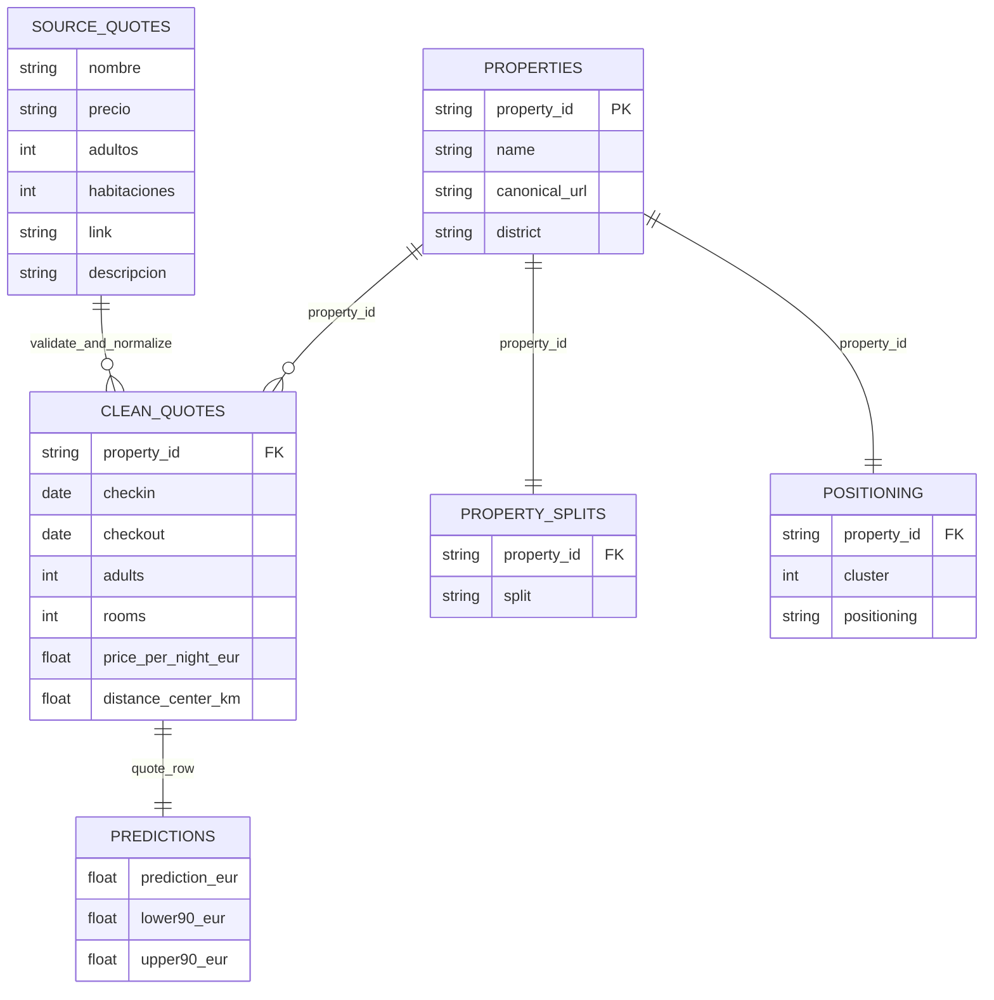

## Cleaning and target definition

1. Normalize Spanish column names and parse explicit EUR price strings (`€ 1.234,50` → 1234.50), review counts (`7.898 comentarios` → 7,898 reviews), and distances (`300 m` → 0.3 km).
2. Extract dates, adults, children, room request and child age from the source URL. Cross-check occupancy against the CSV; reject unexpected adult/child mismatches.
3. Exclude **75 room-count mismatches**. These rows claim two rooms while their Booking URL requests one, so room count is not safely interpretable.
4. Exclude another **150 matching multi-room search rows**. Requested room count is not sufficient evidence that the displayed price covers all those rooms, so we do not divide the price by that count.
5. Deduplicate canonical property + dates + party configuration. Removed duplicate count: **0**. Retain 225 one-room rows; target = **quoted price / number of nights**. Every retained stay is exactly one night, so target equals the displayed source price.
6. Create stable property IDs from canonical property paths. Keep names and URLs for display, never as price-model inputs.
7. Extract **text mentions** of nine amenities. A zero means the keyword was absent, not that the amenity does not exist. A description might mention a nearby or paid service; these are imperfect text proxies rather than verified facilities.
8. Keep missing beach distances as missing (not zero); an explicit missingness indicator is added. The observed missing fraction is **54.7%**. Imputation and encoding are fitted only on each training fold.

Price range in the retained cohort: **€70–€672**, median **€152 / night**. No arbitrary price cap, winsorization or test-set-based outlier removal is used. [Data audit](reports/data_audit.json) contains full counts and missingness.

**Inputs (17):** adults, distance_center_km, distance_beach_km, beach_distance_missing, log_review_count, sustainability_certification, description_missing, mentions_wifi, mentions_pool, mentions_spa, mentions_fitness, mentions_parking, mentions_restaurant, mentions_air_conditioning, mentions_breakfast, mentions_pets, district.

There is **no usable guest-review score or official star category** in this source. The `comentarios` field is a review count, not a rating. City, date, infant count, infant age, room count and stay duration are constants in this cohort and are excluded from learning. Full descriptions, property IDs/names, URLs, observed prices and positioning labels are excluded from regression features.

## Leakage-resistant evaluation

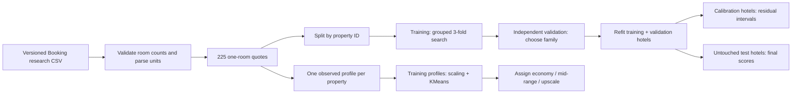

Properties are deterministically shuffled with seed 42 into approximately 60% training, 15% validation, 10% calibration and 15% test groups. All quotes for a property stay together. Consequently, the final price score measures generalization to **unseen establishments**, not memorization of another quote for the same hotel.

| Role | quotes | properties |
| --- | --- | --- |
| train | 132 | 97 |
| validation | 38 | 25 |
| calibration | 22 | 16 |
| test | 33 | 25 |

This is a grouped cross-sectional split, **not a temporal forecast**. A single stay date cannot support an honest seasonal backtest. All quality and segmentation choices are documented without using final test scores to choose the price estimator.

## Regression and hyperparameter optimization

Numeric imputation (training median), standardization and categorical mode imputation / one-hot encoding are inside the model pipeline. Unseen districts are encoded without raising an error. A `log1p` price target reduces the influence of the long upper tail. Inversion returns EUR; negative predictions are clipped at zero for evaluation and inference.

Three families each use four grid combinations and 3-fold **GroupKFold by hotel** (12 combinations, 36 CV fits):

- Random Forest: 200 trees, depths 6/unlimited, minimum leaf sizes 2/5.
- Histogram Gradient Boosting: 180 iterations, 7/15 leaf nodes, L2 regularization 1/10, internal random early stopping disabled.
- XGBoost: 200 trees, learning rate 0.05, depth 2/4, lambda 1/10, histogram tree method.

Search scoring is MAE in original EUR despite fitting the log target. Each family's best candidate is evaluated on independent validation hotels. The smallest validation MAE selects **xgboost**; it is then refitted on training plus validation hotels. Calibration and test properties remain outside that fit.

| Family | Grouped CV MAE (€) | Validation MAE (€) | Best hyperparameters |
| --- | --- | --- | --- |
| random_forest | 34.71 | 37.04 | {"regressor__model__max_depth": null, "regressor__model__min_samples_leaf": 2} |
| gradient_boosting | 39.32 | 39.07 | {"regressor__model__l2_regularization": 10, "regressor__model__max_leaf_nodes": 15} |
| xgboost | 34.85 | 35.64 | {"regressor__model__max_depth": 2, "regressor__model__reg_lambda": 1} |

Full fold and candidate results are in `reports/search_*.csv`.

## Measured test results

| Estimator / baseline | Quotes | MAE (€) | RMSE (€) | R² | Median APE |
| --- | --- | --- | --- | --- | --- |
| selected | 33 | 51.15 | 99.85 | 0.114 | 12.5% |
| global_median | 33 | 69.06 | 119.67 | -0.273 | 24.8% |
| district_occupancy_median | 33 | 50.50 | 91.08 | 0.263 | 18.9% |

Both baselines use the same final test rows as the estimator. The global median is computed on training plus validation quotes. The district/occupancy baseline uses the median for each training district/adult-count combination and falls back to the global median when absent.

Property-cluster bootstrap (2,000 resamples) gives an approximate 95% test-MAE interval of **€27.41–€86.96**. This describes sampling uncertainty on a small selected test set, not a guarantee about future markets. R² can be unstable or negative on small groups; all measured values are kept.

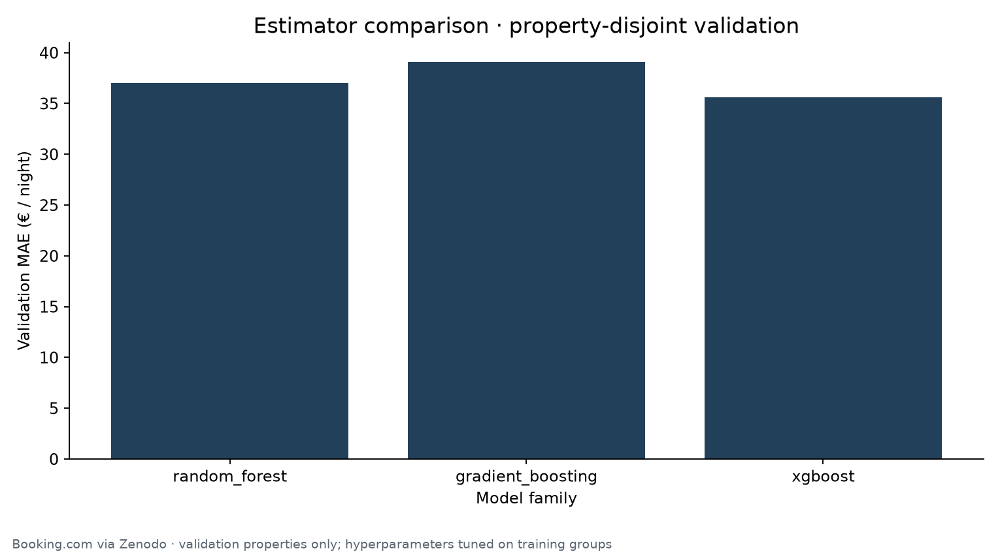
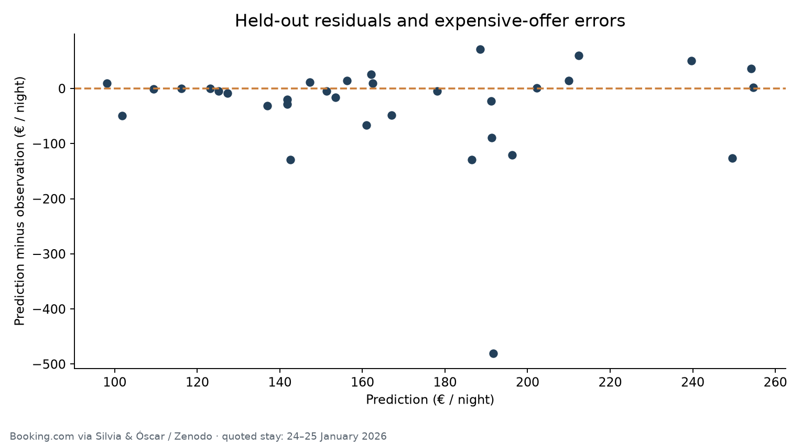
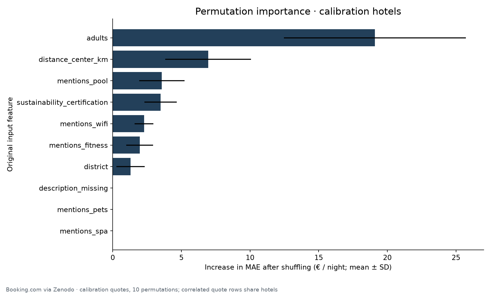

The top measured permutation effects are **adults, distance_center_km, mentions_pool**. These are associations in a fitted predictive model, not causal price effects. Importance uses 10 permutations on calibration quotes; repeated quote rows and correlated features limit its interpretation.

Intervals use each calibration property's **maximum absolute log residual across its observed quotes**. A finite-sample order statistic gives a nominal 90% property-level residual band. Observed test quote coverage is **84.8%** and all-quotes-covered test-property coverage is **80.0%**; median interval width **€141.36**. There are only 16 calibration properties, so bands are coarse. Exchangeability with future hotel markets is not established and coverage for unobserved party configurations is not claimed.

## Statistical and visual analysis

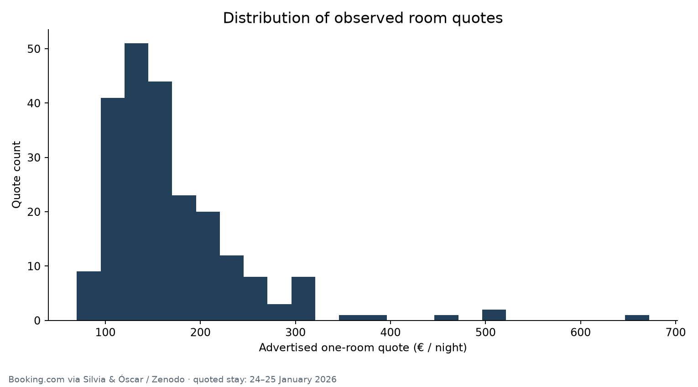
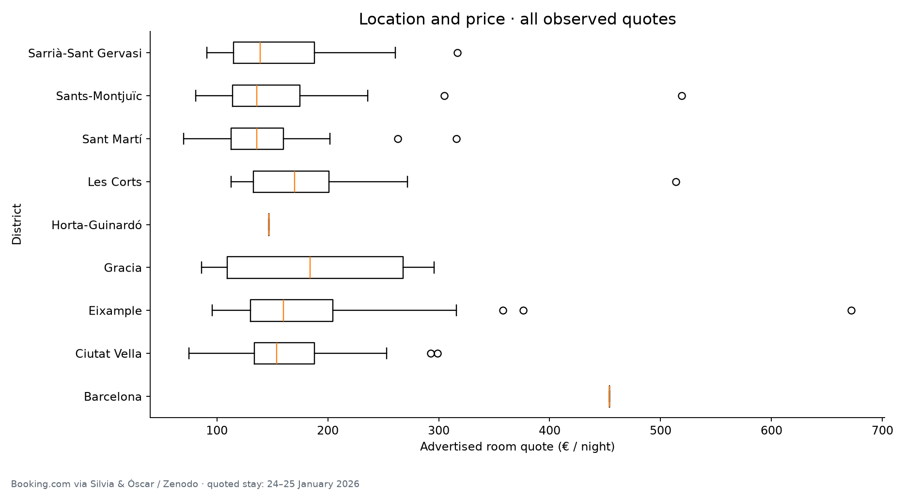
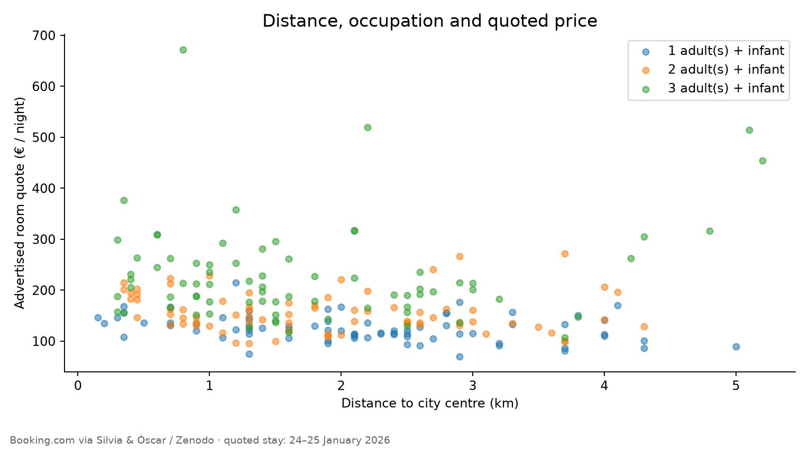
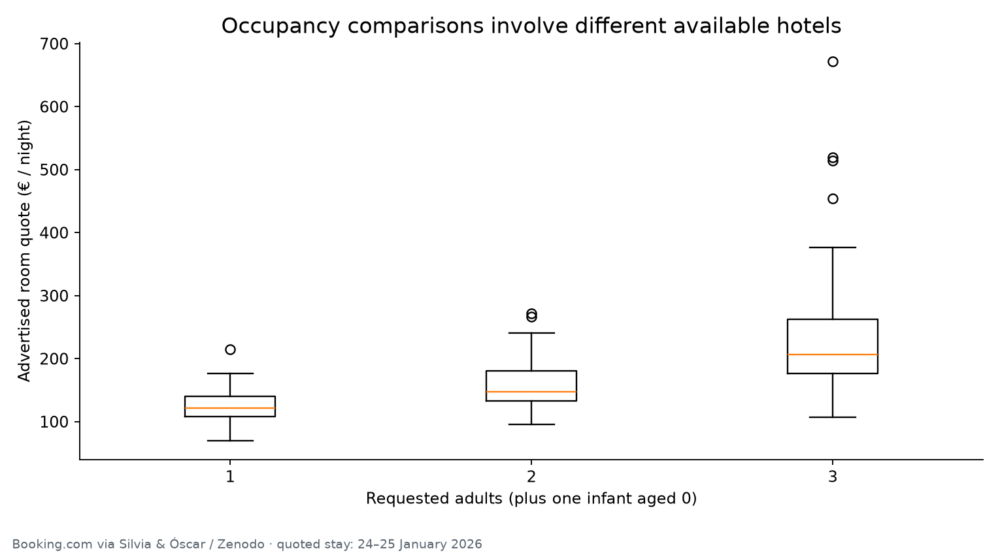
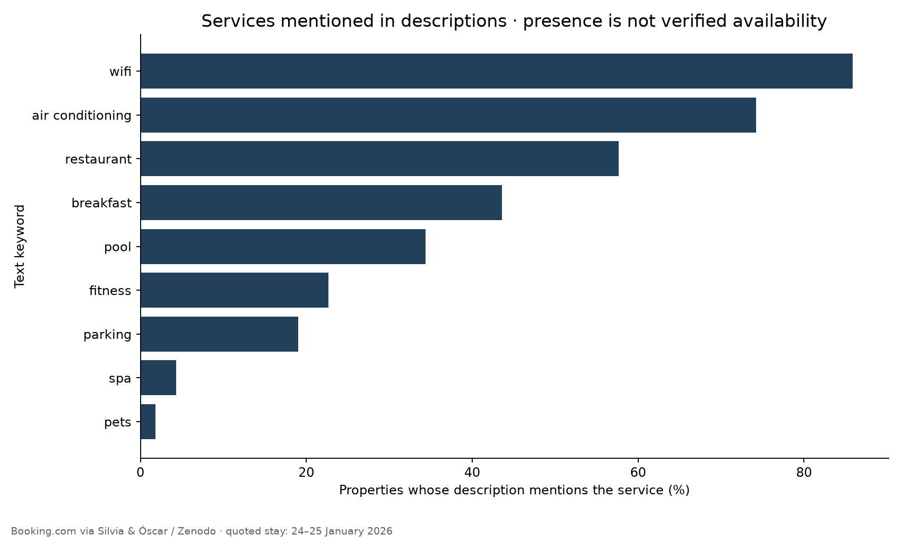

For exploratory inferential statistics, we use **one median-price row per property** rather than treating repeated quotes for the same establishment as independent observations.

| Indicator | Property-level Spearman rho | Unadjusted p | Properties |
| --- | --- | --- | --- |
| center_km | -0.237 | 0.002344 | 163 |
| reviews | -0.158 | 0.04421 | 163 |
| amenity_mentions | -0.081 | 0.3068 | 163 |

District Kruskal–Wallis statistic: **8.74**, unadjusted p **0.1885**, across districts containing at least three properties. This is an exploratory difference in distributions, not a controlled estimate of location's causal effect. The snapshot is a selected top-search-result sample, p-values are unadjusted and occupancy mixes differ between properties. See [statistical results](reports/statistical_results.json) and [district summary](reports/district_summary.csv).

## K-Means hotel positioning

Clustering uses one row per establishment: **log_median_price, distance_center_km, log_review_count, amenity_mentions_count**. Median price is computed over the available 1–3-adult quotes for that property; not every hotel appears for every occupancy configuration. This can affect positioning and is explicitly a descriptive limitation.

The imputer, scaler and centroids are fitted only on training/validation properties. After standardization, feature weights are 2.0 for log median price, 0.5 for centre distance, 0.25 for log review count and 0.5 for amenity mentions. This explicit price-led positioning rule prevents review popularity or service-text length from dominating the requested economic tiers; it is a business design choice, not an optimized claim about hotel quality. **k=3 is fixed to deliver the requested economy/mid-range/upscale taxonomy.** Scores for k=2–6 are reported as diagnostics; the best diagnostic k is **2**, which is not silently substituted for three. Seed 42 and 30 initializations are used.

Cluster IDs are arbitrary. The three training clusters are named by ascending training-property median observed price. These are **relative market-positioning labels**, not official hotel categories, quality guarantees or supervised classification accuracy claims. K-Means assignment for a new property requires an observed median quote profile; price prediction itself does not require an observed price or a cluster label.

| positioning | properties | median_price_eur | center_km | amenity_mentions |
| --- | --- | --- | --- | --- |
| Economy | 89 | 132.5 | 2.1 | 3.0 |
| Mid-range | 62 | 197.5 | 1.2 | 3.0 |
| Upscale | 12 | 316.0 | 1.8 | 3.0 |

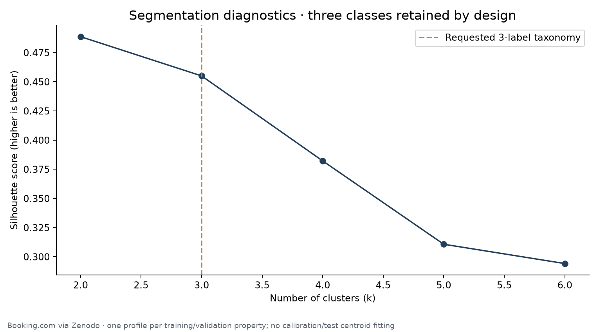
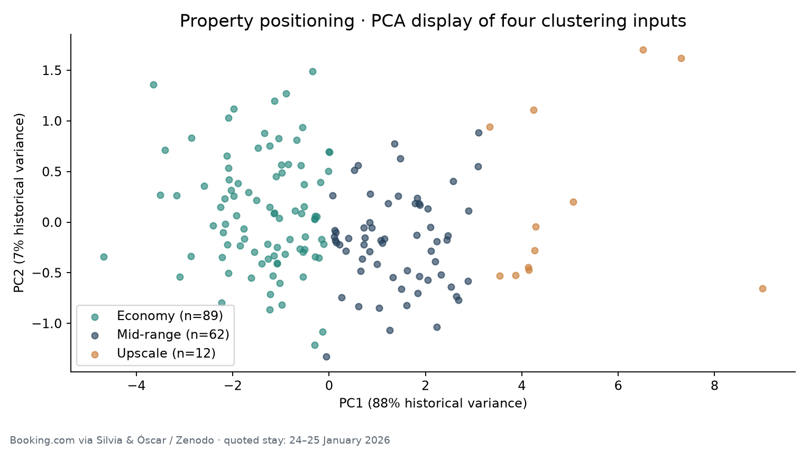
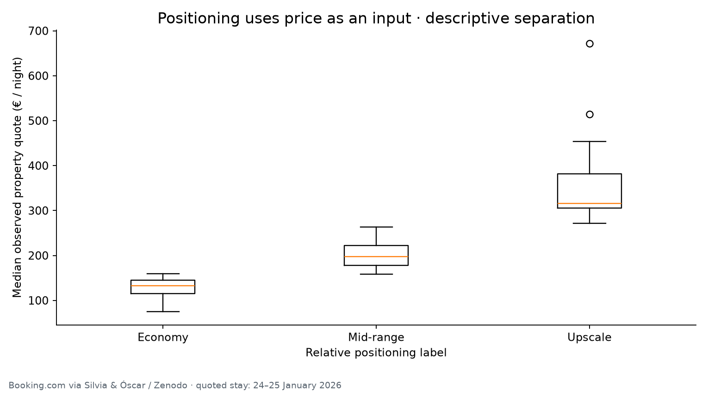

PCA is used only to display clusters in two dimensions; K-Means operates on all four weighted standardized inputs. Because price is included in clustering, price separation between the resulting groups is expected and is not independent validation of a pricing model. Group price ranges may overlap. Assigned property labels and cluster inputs are in [property_profiles.csv](reports/property_profiles.csv).

## Dashboard

Open [dashboard/index.html](dashboard/index.html) directly, or serve the repository using `python -m http.server 8000`.

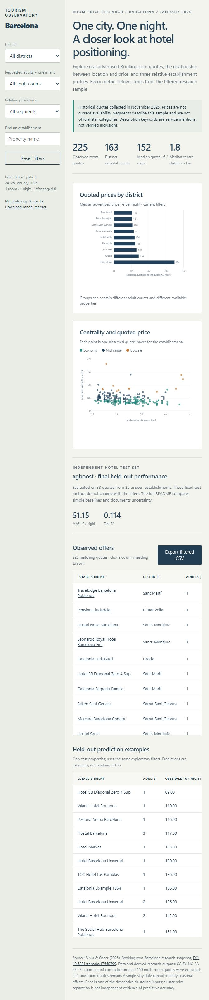

- Filter by district, adults, positioning and property name; reset filters with one click.
- Inspect dynamically updated quote counts, property counts, median price and central distance.
- Compare district medians and the central-distance/price relationship with units and source context.
- Sort quotes and open canonical source property links; export the filtered real rows to CSV.
- Inspect **test-only** observed/predicted prices separately from the full descriptive dataset. Training estimates are not presented as holdout results.
- The dashboard's model-quality panel reports the fixed held-out test score, independently of exploratory filters.

The dashboard displays the dated snapshot, not live availability. Only a partial search sample is observed; it is not a complete Barcelona hotel inventory. Data and code use no external browser dependencies, so the dashboard can be opened offline.

## Real prediction examples

These are actual held-out properties and quotes, not illustrative synthetic hotel records:

| name | adults | price_per_night_eur | prediction_eur | lower90_eur | upper90_eur |
| --- | --- | --- | --- | --- | --- |
| Ako Suite Hotel | 3 | €214.00 | €191.21 | €125.19 | €291.77 |
| Barceló Raval | 3 | €253.00 | €254.69 | €166.87 | €388.47 |
| Catalonia Passeig de Gràcia 4* Sup | 1 | €156.00 | €151.30 | €98.99 | €230.99 |
| Catalonia Passeig de Gràcia 4* Sup | 2 | €201.00 | €202.27 | €132.45 | €308.61 |
| Residencia Universitaria Resa Campus del Mar | 3 | €227.00 | €161.00 | €105.36 | €245.76 |

```bash
python -m src.predict --input examples/hotel.csv --output examples/prediction.csv
```

All 17 named input columns are required. Numeric missingness is imputed inside the fitted pipeline. `adults` must remain in the observed 1–3 range; binary service-mention columns accept 0/1. Prices returned are EUR per night for the fixed one-room, one-infant, one-night research context. Other dates, cities, children or room types require new collection and retraining; the interface does not manufacture seasonal effects.

## Reproducibility and project structure

```text
src/collect.py     Versioned Zenodo download and checksums
src/scrape.py      Optional respectful Booking HTML scraper
src/prepare.py     Occupancy checks, unit parsing and feature extraction
src/model.py       Shared preprocessing, metrics and input validation
src/train.py       Property splits, three grid searches, intervals and KMeans
src/predict.py     Batch room-price inference and observed-profile assignment
src/report.py      Statistics, 12 figures, README, notebook and dashboard
src/run.py         End-to-end entry point
artifacts/        Fitted regression and positioning models
data/processed/   Canonical sanitized quote dataset
dashboard/        Self-contained interactive tourism analysis
reports/          Measured scores, splits, profiles, statistics and PNG/SVG figures
notebooks/        Exploratory analysis notebook
examples/         Real held-out input and model output
tests/            Parsing, occupancy, leakage and inference contracts
.github/          Automated tests on push / pull request
```

The notebook requires Jupyter separately. The pipeline and dashboard do not. Graphs are exported as both PNG for README rendering and SVG for reuse. The [verification record](reports/verification.json) records the actual local checks; GitHub Actions provides separate remote test status.

## Limitations and next steps

- **One city and one stay date:** seasonal effects, multi-city transferability and temporal drift cannot be estimated. A future collection should repeat the same hotels across seasons with fixed occupancy, room type and booking lead time, then use a temporal backtest.
- **Missing category/rating fields:** neither official stars nor guest scores are available. We retain review counts and text-derived service mentions with their proper meanings.
- **Offer comparability:** actual room type, cancellation conditions, meals and tax inclusion are not recorded. Advertised search-result prices can represent different room offers, even under the same requested occupancy.
- **Scraper availability:** the live request did not yield parseable listing cards. This project does not claim successful fresh Booking collection; the automatic published-snapshot route is the executed source.
- **Small selected sample:** only the first 75 results per search configuration were published. Filtering leaves 225 quotes and 163 properties; validation and test estimates have substantial uncertainty.
- **Keyword noise:** amenities may be mentioned negatively, as nearby facilities or as paid extras. These inputs measure text mentions, not confirmed inclusion in a tariff.
- **Observed positioning:** clusters use median observed prices and an uneven occupancy mix; labels are relative to this sample and may be unstable under another collection.
- **No causal inference:** correlations, group tests and permutation importance reveal associations. They cannot show that adding a service would raise a hotel's price by a given amount.
- **Research use:** the data license is noncommercial and share alike. A commercial pricing system needs appropriately licensed data and substantially broader validation.

## References

- [Original Booking.com dataset, authors, version and license](https://zenodo.org/records/17560799)
- [CC BY-NC-SA 4.0 terms](https://creativecommons.org/licenses/by-nc-sa/4.0/)
- [scikit-learn grouped cross-validation](https://scikit-learn.org/stable/modules/cross_validation.html#cross-validation-iterators-for-grouped-data)
- [scikit-learn permutation importance](https://scikit-learn.org/stable/modules/permutation_importance.html)
- [scikit-learn K-Means](https://scikit-learn.org/stable/modules/clustering.html#k-means)
- [XGBoost Python API](https://xgboost.readthedocs.io/en/stable/python/python_api.html)

No affiliation with Booking.com, Hotels.com or the dataset authors is implied.
